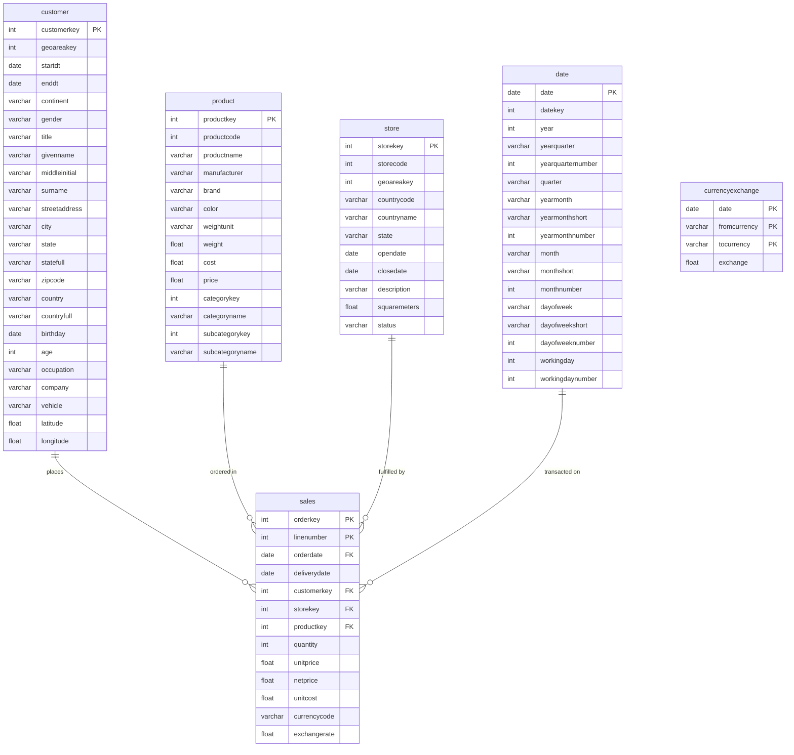
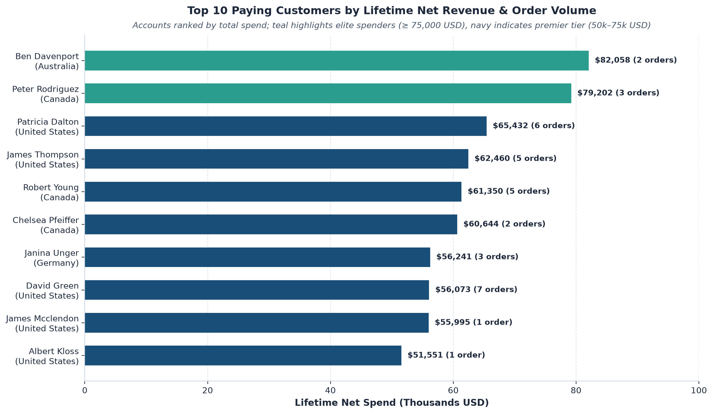
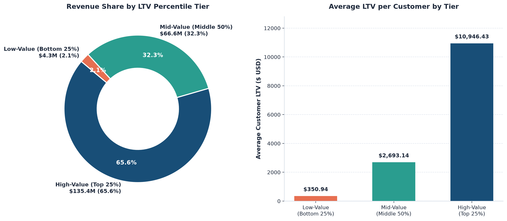
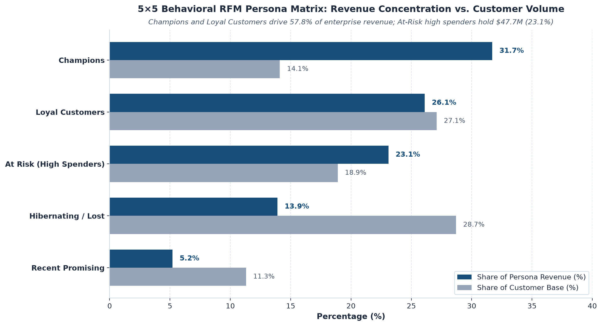
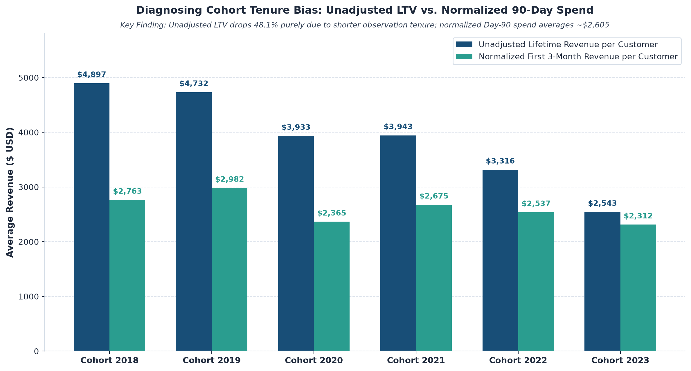
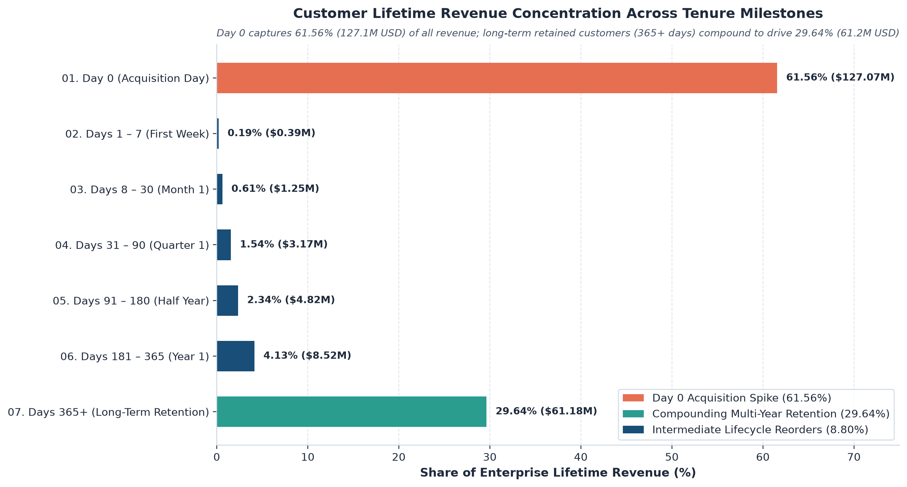
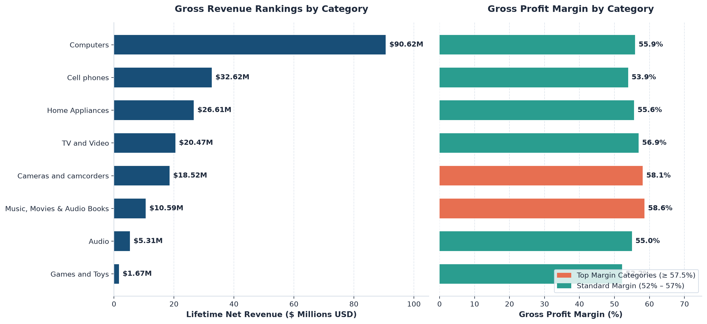
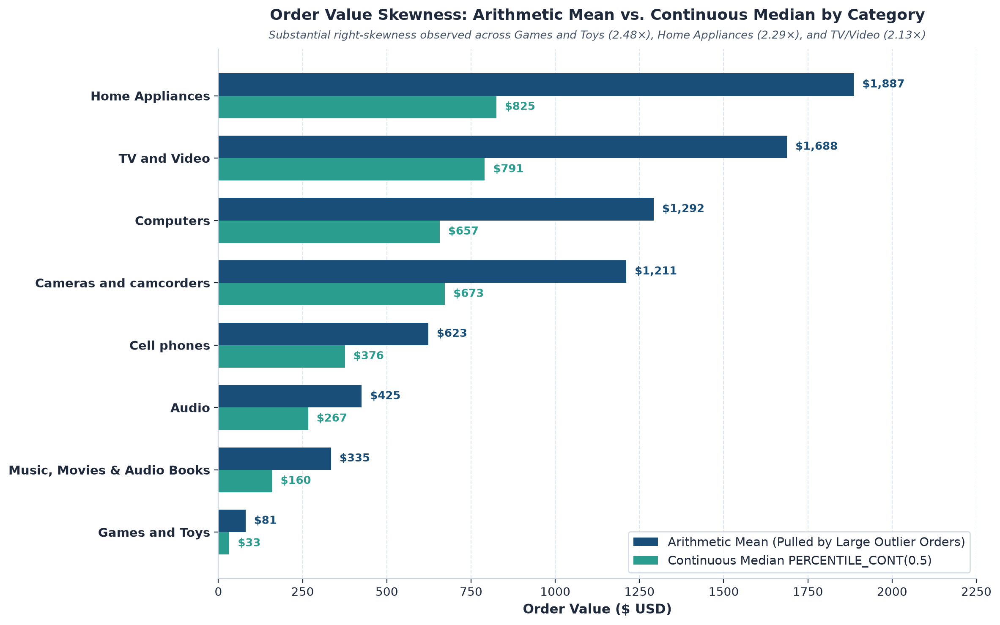
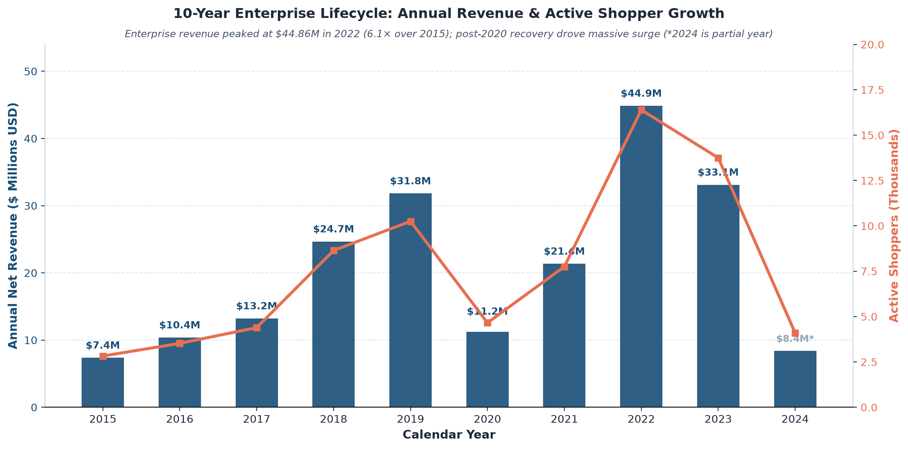

# 🛒 Contoso E-Commerce: SQL Analytics & Customer Intelligence


---

# Introduction

📊 Dive into 10+ years of global retail enterprise data! Building upon a star-schema warehouse, this portfolio project transforms **100,000+ transaction lines** across **49,487 customers**, **3 continents**, and **8 product categories** into actionable executive business intelligence.

Using **PostgreSQL 16**, **DBeaver**, and a unified **white-theme editorial visualization suite** (authored in Python with Matplotlib), this project investigates customer lifetime value (LTV) percentiles, cohort decay dynamics, 5×5 behavioral RFM matrices, multi-year product pivots, statistical skewness, and 10-year macro growth trajectories.

🔍 SQL queries? Explore all 8 self-contained analytical scripts directly in this repository:
1. [1_top_paying_customers.sql](1_top_paying_customers.sql)
2. [2_customer_segmentation_pareto.sql](2_customer_segmentation_pareto.sql)
3. [3_rfm_customer_personas.sql](3_rfm_customer_personas.sql)
4. [4_cohort_tenure_normalization.sql](4_cohort_tenure_normalization.sql)
5. [5_revenue_power_law_decay.sql](5_revenue_power_law_decay.sql)
6. [6_product_category_performance.sql](6_product_category_performance.sql)
7. [7_order_value_skewness.sql](7_order_value_skewness.sql)
8. [8_annual_macro_trends.sql](8_annual_macro_trends.sql)

---

# Background

For multinational retail enterprises like Contoso, sustainable profitability requires understanding which customer segments, merchandising categories, and retention behaviors drive long-term cash flow.

This project investigates the full **10-year enterprise lifecycle (2015 – 2024)**, controlling for cohort tenure bias, uncovering gross profit margin disparities across catalog lines, and mapping customer lifecycle spend velocity.

### The questions I wanted to answer through my SQL queries were:

1. **Who are our highest-spending customers**, and how is lifetime spend distributed across global geographies?
2. **How concentrated is enterprise revenue across customer tiers**, and does it follow the classic 80/20 Pareto principle?
3. **What distinct behavioral personas exist** when classifying customers across Recency, Frequency, and Monetary (RFM) dimensions?
4. **Is customer quality deteriorating over time**, or are newer cohorts simply victims of observation tenure bias?
5. **At what rate does customer spend decay after acquisition**, and how critical is Day 0 to total enterprise cash flow?
6. **Which merchandise categories generate the highest gross profit margins** versus pure top-line revenue volume?
7. **How skewed is customer order value** across product categories when comparing parametric averages to non-parametric continuous medians?
8. **What is Contoso's macro 10-year growth trajectory**, and how do annual active shopper counts correlate with year-over-year revenue expansion?

---

# Data Model Architecture

The database is architected as a high-performance **star schema**, centered around the `sales` fact table connected to core dimension tables (`customer`, `product`, `store`, `date`):



Database creation, table definition, and data loading scripts are organized in the [`sql_load/`](sql_load/) directory:
- [`sql_load/1_create_database.sql`](sql_load/1_create_database.sql)
- [`sql_load/2_create_tables.sql`](sql_load/2_create_tables.sql)
- [`sql_load/3_load_data.sql`](sql_load/3_load_data.sql)

---

# Tools I Used

- **PostgreSQL:** Analytical database engine utilized for analytical window functions (`LAG()`, `ROW_NUMBER()`, `NTILE()`, `SUM() OVER ()`), continuous statistical percentiles (`PERCENTILE_CONT`), multi-table joins, and Common Table Expressions (CTEs).
- **DBeaver Universal Database Tool:** SQL authoring, relational data modeling, query execution profiling, and `EXPLAIN ANALYZE` execution plan benchmarking.
- **Git & GitHub:** Version control, modular SQL code management, and portfolio documentation.

---

# The Analysis

### 1. Top Paying Customers by Lifetime Net Revenue
📁 SQL File: [1_top_paying_customers.sql](1_top_paying_customers.sql)

To evaluate high-value accounts across global markets, this query standardizes customer demographics using text cleaning functions (`INITCAP`, `TRIM`, `CONCAT`), handles missing attributes with `COALESCE`, and aggregates lifetime net revenue, total order volume, and Average Order Value (AOV).

```sql
WITH customer_spending AS (
    SELECT
        s.customerkey,
        CONCAT(INITCAP(TRIM(COALESCE(c.givenname, ''))), ' ', INITCAP(TRIM(COALESCE(c.surname, '')))) AS customer_name,
        COALESCE(c.countryfull, 'N/A') AS country,
        COALESCE(c.continent, 'N/A') AS continent,
        c.age,
        COUNT(DISTINCT s.orderkey) AS total_orders,
        ROUND(SUM(s.quantity * s.netprice * s.exchangerate)::numeric, 2) AS lifetime_net_spend_usd,
        ROUND((SUM(s.quantity * s.netprice * s.exchangerate) / COUNT(DISTINCT s.orderkey))::numeric, 2) AS avg_order_value_usd,
        MIN(s.orderdate) AS first_purchase_date,
        MAX(s.orderdate) AS latest_purchase_date
    FROM sales s
    JOIN customer c ON s.customerkey = c.customerkey
    GROUP BY
        s.customerkey,
        c.givenname,
        c.surname,
        c.countryfull,
        c.continent,
        c.age
)
SELECT
    customerkey,
    customer_name,
    country,
    continent,
    age,
    total_orders,
    lifetime_net_spend_usd,
    avg_order_value_usd,
    first_purchase_date,
    latest_purchase_date
FROM customer_spending
ORDER BY
    lifetime_net_spend_usd DESC
LIMIT 10;
```

**Results (Top 10 Enterprise Customers by Net Spend):**

| customerkey | customer_name | country | continent | age | total_orders | lifetime_net_spend_usd | avg_order_value_usd | first_purchase_date | latest_purchase_date |
| :--- | :--- | :--- | :--- | ---: | ---: | ---: | ---: | :---: | :---: |
| 72844 | Ben Davenport | Australia | Australia | 27 | 2 | **$82,057.67** | $41,028.83 | 2019-10-08 | 2022-10-17 |
| 399184 | Peter Rodriguez | Canada | North America | 23 | 3 | **$79,201.82** | $26,400.61 | 2016-01-06 | 2020-05-13 |
| 1743963 | Patricia Dalton | United States | North America | 79 | 6 | **$65,431.98** | $10,905.33 | 2017-12-22 | 2023-08-28 |
| 1232832 | James Thompson | United States | North America | 51 | 5 | **$62,460.01** | $12,492.00 | 2016-10-21 | 2023-06-26 |
| 326979 | Robert Young | Canada | North America | 19 | 5 | **$61,349.65** | $12,269.93 | 2016-02-25 | 2022-10-11 |
| 368574 | Chelsea Pfeiffer | Canada | North America | 21 | 2 | **$60,644.48** | $30,322.24 | 2019-02-22 | 2020-01-11 |
| 552225 | Janina Unger | Germany | Europe | 22 | 3 | **$56,240.85** | $18,746.95 | 2016-10-05 | 2022-02-23 |
| 1375597 | David Green | United States | North America | 69 | 7 | **$56,073.21** | $8,010.46 | 2019-07-02 | 2023-05-25 |
| 1852945 | James Mcclendon | United States | North America | 63 | 1 | **$55,994.75** | $55,994.75 | 2017-02-13 | 2017-02-13 |
| 1715500 | Albert Kloss | United States | North America | 31 | 1 | **$51,550.86** | $51,550.86 | 2018-08-28 | 2018-08-28 |


*Figure 1: Top 10 Highest-Spending Customers by Lifetime Net Revenue & Order Volume ([`assets/fig1_top_customers.png`](assets/fig1_top_customers.png)).*

- **Concentrated Spender Economics:** The top 10 accounts aggregate **$630,965.48** in lifetime spend across 35 orders, generating an extraordinary Average Order Value (AOV) of **$18,027.59**.
- **Top Individual Spender:** **Ben Davenport (Australia)** leads all Contoso customers with **$82,057.67** across 2 purchases ($41,028.83 AOV), followed closely by **Peter Rodriguez (Canada)** at **$79,201.82** across 3 purchases ($26,400.61 AOV).
- **Geographic Dispersion:** High-ticket accounts are concentrated in North America (United States: 5, Canada: 3), Europe (Germany: 1), and Australia (1), reflecting widespread international adoption for premium electronics.

---

### 2. Customer Segmentation & Pareto Distribution
📁 SQL File: [2_customer_segmentation_pareto.sql](2_customer_segmentation_pareto.sql)

To evaluate customer spending concentration without arbitrary cutoff bias, this query computes exact 25th and 75th percentiles of customer Lifetime Value (LTV) using `PERCENTILE_CONT()`, establishing objective **Low-Value (Bottom 25%)**, **Mid-Value (Middle 50%)**, and **High-Value (Top 25%)** tiers.

```sql
WITH customer_ltv_summary AS (
    SELECT
        s.customerkey,
        SUM(s.quantity * s.netprice * s.exchangerate) AS total_ltv
    FROM sales s
    GROUP BY
        s.customerkey
),
ltv_percentile_thresholds AS (
    SELECT
        PERCENTILE_CONT(0.25) WITHIN GROUP (ORDER BY total_ltv) AS p25_ltv,
        PERCENTILE_CONT(0.75) WITHIN GROUP (ORDER BY total_ltv) AS p75_ltv
    FROM customer_ltv_summary
),
customer_segments AS (
    SELECT
        c.customerkey,
        c.total_ltv,
        CASE
            WHEN c.total_ltv < p.p25_ltv THEN '1 - Low-Value (Bottom 25%)'
            WHEN c.total_ltv BETWEEN p.p25_ltv AND p.p75_ltv THEN '2 - Mid-Value (Middle 50%)'
            ELSE '3 - High-Value (Top 25%)'
        END AS customer_segment
    FROM customer_ltv_summary c
    CROSS JOIN ltv_percentile_thresholds p
)
SELECT
    customer_segment,
    COUNT(customerkey) AS customer_count,
    ROUND((100.0 * COUNT(customerkey) / (SELECT COUNT(*) FROM customer_segments))::numeric, 1) AS pct_of_customers,
    ROUND(SUM(total_ltv)::numeric, 2) AS total_segment_revenue,
    ROUND((100.0 * SUM(total_ltv) / (SELECT SUM(total_ltv) FROM customer_segments))::numeric, 1) AS pct_of_total_revenue,
    ROUND((SUM(total_ltv) / COUNT(customerkey))::numeric, 2) AS avg_ltv_per_customer
FROM customer_segments
GROUP BY
    customer_segment
ORDER BY
    total_segment_revenue DESC;
```

**Results (LTV Percentile Breakdown across 49,487 Customers):**

|customer_segment          |customer_count|pct_of_customers|total_segment_revenue|pct_of_total_revenue|avg_ltv_per_customer|
|--------------------------|--------------|----------------|---------------------|--------------------|--------------------|
|🔴 High-Value |12372         |25.0            |135429277.27         |65.6                |10946.43            |
|🟡 Mid-Value |24743         |50.0            |66636451.79          |32.3                |2693.14             |
|🟢 Low-Value|12372         |25.0            |4341809.53           |2.1                 |350.94              |


*Figure 2: Revenue Share & Average LTV by Customer Segment ([`assets/fig2_customer_segmentation_pareto.png`](assets/fig2_customer_segmentation_pareto.png)).*

- **The Pareto Rule in Action:** The top quartile of customers accounts for **65.6% of all enterprise revenue** ($135.43M), with an average LTV of **$10,946.43**.
- **Mid-Value Core Engine:** Mid-Value customers comprise **50.0% of the customer base** and generate **32.3% of revenue** ($66.64M) with an average LTV of **$2,693.14**.
- **The Long Tail:** The bottom 25% of customers contributes just **2.1% of total revenue** ($4.34M) with an average LTV of **$350.94**, indicating a large base of single-purchase, small-basket shoppers.

---

### 3. 5×5 Behavioral RFM Customer Personas
📁 SQL File: [3_rfm_customer_personas.sql](3_rfm_customer_personas.sql)

A 5×5 behavioral RFM grid maps customers across a 1–5 scale for Recency (how recently they bought) and Frequency (how often they buy), while using Monetary value (how much they spend) as a tie-breaker, overlay, or third dimension.

To move beyond static revenue tiers, this query builds a multi-dimensional behavioral segmentation matrix using `NTILE(5)` across **Recency** (days since last purchase), **Frequency** (distinct order count), and **Monetary** value (lifetime net spend).

```sql
WITH customer_rfm_raw AS (
    SELECT
        customerkey,
        MAX(orderdate) AS last_order_date,
        (SELECT MAX(orderdate) FROM sales) - MAX(orderdate) AS recency_days,
        COUNT(DISTINCT orderkey) AS num_orders,
        SUM(quantity * netprice * exchangerate) AS ltv_revenue
    FROM sales
    GROUP BY
        customerkey
), rfm_scores AS (
    SELECT
        customerkey,
        recency_days,
        num_orders,
        ltv_revenue,
        NTILE(5) OVER (ORDER BY recency_days DESC) AS r_score,
        NTILE(5) OVER (ORDER BY num_orders ASC) AS f_score,
        NTILE(5) OVER (ORDER BY ltv_revenue ASC) AS m_score
    FROM customer_rfm_raw
)
SELECT
    CASE
        WHEN r_score >= 4 AND f_score >= 4 AND m_score >= 4 THEN 'Champions'
        WHEN r_score >= 3 AND f_score >= 3 THEN 'Loyal Customers'
        WHEN r_score >= 4 AND f_score <= 2 THEN 'Recent Promising'
        WHEN r_score <= 2 AND f_score >= 3 THEN 'At Risk (High Spenders)'
        ELSE 'Hibernating / Lost'
    END AS rfm_persona,
    COUNT(customerkey) AS total_customers,
    ROUND((100.0 * COUNT(customerkey) / (SELECT COUNT(*) FROM rfm_scores))::numeric, 2) AS pct_of_customers,
    ROUND(AVG(ltv_revenue)::numeric, 2) AS avg_spend,
    ROUND(SUM(ltv_revenue)::numeric, 2) AS total_persona_revenue,
    ROUND((100.0 * SUM(ltv_revenue) / (SELECT SUM(ltv_revenue) FROM rfm_scores))::numeric, 1) AS pct_total_revenue
FROM rfm_scores
GROUP BY
    1
ORDER BY
    total_persona_revenue DESC;
```

**Results (RFM Persona Matrix Performance):**

|rfm_persona               |total_customers|pct_of_customers|avg_spend   |total_persona_revenue|pct_total_revenue|
|--------------------------|---------------|----------------|------------|---------------------|-----------------|
|Champions                 |6959           |14.06           |9416.19     |65527234.38          |31.7             |
|Loyal Customers           |13390          |27.06           |4024.26     |53884886.28          |26.1             |
|At Risk (High Spenders)   |9342           |18.88           |5106.58     |47705657.59          |23.1             |
|Hibernating / Lost        |14189          |28.67           |2016.00     |28605043.35          |13.9             |
|Recent Promising          |5607           |11.33           |1905.60     |10684716.97          |5.2              |



*Figure 3: 5×5 RFM Persona Matrix: Revenue Concentration vs. Customer Volume ([`assets/fig3_rfm_customer_personas.png`](assets/fig3_rfm_customer_personas.png)).*

- **Champions Anchor Enterprise Value:** Just **14.1% of customers (6,959 Champions)** produce **31.7% of enterprise revenue ($65.53M)** with an average spend of **$9,416.19**.
- **Loyal Customer Backbone:** **Loyal Customers** comprise 27.1% of accounts (13,390 customers) delivering **26.1% of enterprise revenue ($53.88M)** with an average spend of **$4,024.26**.
- **At-Risk Capital Exposure:** The **At Risk (High Spenders)** segment represents **9,342 customers accounting for $47.71M (23.1% of total enterprise cash flow)** who have spent heavily in the past but are actively lapsing, making them the #1 target for automated retention campaigns.

---

### 4. Cohort Evolution & Tenure Bias Normalization
📁 SQL File: [4_cohort_tenure_normalization.sql](4_cohort_tenure_normalization.sql) 

Evaluating raw customer lifetime spend across historical cohorts creates a severe mathematical illusion: older cohorts appear to have significantly higher customer quality simply because they have had 5+ years of accumulation. To eliminate tenure bias, this query normalizes observation windows to each customer's **first 3 months** (`orderdate <= first_purchase_date + INTERVAL '3 months'`).

```sql
WITH customer_orders AS (
    SELECT
        customerkey,
        orderdate,
        quantity * netprice * exchangerate AS line_revenue,
        MIN(orderdate) OVER (PARTITION BY customerkey) AS first_purchase_date
    FROM sales
),
customer_summary AS (
    SELECT
        customerkey,
        EXTRACT(YEAR FROM first_purchase_date)::int AS cohort_year,
        SUM(line_revenue) AS total_ltv,
        SUM(
            CASE
                WHEN orderdate <= first_purchase_date + INTERVAL '3 months'
                THEN line_revenue
                ELSE 0
            END
        ) AS ltv_3months
    FROM customer_orders
    GROUP BY
        customerkey,
        first_purchase_date
)
SELECT
    cohort_year,
    COUNT(customerkey) AS acquired_customers,
    ROUND((SUM(total_ltv) / COUNT(customerkey))::numeric, 2) AS unadjusted_all_time_avg_ltv,
    ROUND((SUM(ltv_3months) / COUNT(customerkey))::numeric, 2) AS normalized_3month_avg_revenue
FROM customer_summary
WHERE cohort_year BETWEEN 2018 AND 2023
GROUP BY
    cohort_year
ORDER BY
    cohort_year;
```

**Results (Unadjusted Lifetime vs. Normalized 90-Day Cohort Spend):**

|cohort_year               |acquired_customers|unadjusted_all_time_avg_ltv|normalized_3month_avg_revenue|
|--------------------------|------------------|---------------------------|-----------------------------|
|2018                      |7446              |4896.64                    |2762.87                      |
|2019                      |7755              |4731.95                    |2982.28                      |
|2020                      |3031              |3933.32                    |2364.63                      |
|2021                      |4663              |3943.33                    |2674.61                      |
|2022                      |9010              |3315.52                    |2536.60                      |
|2023                      |5890              |2543.18                    |2311.63                      |



*Figure 4: Diagnosing Cohort Tenure Bias: Unadjusted LTV vs. Normalized 90-Day Spend ([`assets/fig4_cohort_ltv_evolution.png`](assets/fig4_cohort_ltv_evolution.png)).*

- **Tenure Bias Debunked:** While unadjusted LTV drops by **48.1%** from 2018 ($4,896.64) to 2023 ($2,543.18) due to truncated observation windows, normalized 90-day spend remains remarkably steady (**$2,311.63 – $2,982.28**, averaging **~$2,605** across all cohorts).
- **Consistent Acquisition Quality:** Customer acquisition quality has not deteriorated over the 6-year period; newer cohorts simply require operational calendar time to compound repeat purchases into higher lifetime values.

---

### 5. Lifetime Revenue Concentration: Day-0 Power-Law Decay
📁 SQL File: [5_revenue_power_law_decay.sql](5_revenue_power_law_decay.sql) 

To map the exact velocity at which customer revenue accumulates across the relationship lifecycle, this query measures days elapsed from acquisition date (`orderdate - first_order_date`) and bins lifetime enterprise revenue across distinct tenure milestones.

```sql
WITH customer_acquisition AS (
    SELECT 
        customerkey, 
        MIN(orderdate) AS first_order_date
    FROM sales 
    GROUP BY 
        customerkey
),
order_day_deltas AS (
    SELECT 
        s.customerkey,
        (s.orderdate - ca.first_order_date) AS days_since_first_purchase,
        (s.quantity * s.netprice * s.exchangerate) AS order_revenue
    FROM sales s
    JOIN customer_acquisition ca ON s.customerkey = ca.customerkey
),
binned_days AS (
    SELECT
        CASE
            WHEN days_since_first_purchase = 0 THEN '01. Day 0 (Acquisition Day)'
            WHEN days_since_first_purchase BETWEEN 1 AND 7 THEN '02. Days 1 – 7 (First Week)'
            WHEN days_since_first_purchase BETWEEN 8 AND 30 THEN '03. Days 8 – 30 (Month 1)'
            WHEN days_since_first_purchase BETWEEN 31 AND 90 THEN '04. Days 31 – 90 (Quarter 1)'
            WHEN days_since_first_purchase BETWEEN 91 AND 180 THEN '05. Days 91 – 180 (Half Year)'
            WHEN days_since_first_purchase BETWEEN 181 AND 365 THEN '06. Days 181 – 365 (Year 1)'
            ELSE '07. Days 365+ (Long-Term Retention)'
        END AS tenure_bucket,
        order_revenue
    FROM order_day_deltas
)
SELECT 
    tenure_bucket,
    ROUND(SUM(order_revenue)::numeric, 2) AS total_revenue_usd,
    ROUND(
        (100.0 * SUM(order_revenue) / 
        (SELECT SUM(quantity * netprice * exchangerate) FROM sales))::numeric, 
        2
    ) AS pct_of_all_time_revenue
FROM binned_days
GROUP BY 
    tenure_bucket
ORDER BY 
    tenure_bucket;
```

**Results (Revenue Distribution by Customer Lifecycle Milestone):**
|tenure_bucket             |total_revenue_usd|pct_of_all_time_revenue|
|--------------------------|-----------------|-----------------------|
|01. Day 0 (Acquisition Day)|127070684.34     |61.56                  |
|02. Days 1 – 7 (First Week)|386113.90        |0.19                   |
|03. Days 8 – 30 (Month 1) |1252877.41       |0.61                   |
|04. Days 31 – 90 (Quarter 1)|3174720.41       |1.54                   |
|05. Days 91 – 180 (Half Year)|4823645.83       |2.34                   |
|06. Days 181 – 365 (Year 1)|8521016.32       |4.13                   |
|07. Days 365+ (Long-Term Retention)|61178480.38      |29.64                  |



*Figure 5: Customer Lifetime Revenue Concentration: The Power-Law Day-0 Drop ([`assets/fig5_revenue_decay_days.png`](assets/fig5_revenue_decay_days.png)).*

- **The Day-0 Dominance:** **61.56% of enterprise revenue ($127.07M)** is captured on Day 0 (first transaction), demonstrating that initial basket size, onboarding incentives, and immediate cross-selling drive overall enterprise cash flow.
- **Multi-Year Compounding (Days 365+):** Beyond the first year, retained loyal accounts generate **29.64% of lifetime revenue ($61.18M)**, serving as Contoso's second major revenue pillar.
- **First-Year Decay Velocity:** Across Days 1 through 365, cumulative incremental revenue represents **8.80% ($18.16M)**, showing that re-engagement cadences between Days 14–90 are essential to accelerate replenishment before accounts hibernate.

---

### 6. Product Category Revenue Rankings & Profit Margins
📁 SQL File: [6_product_category_performance.sql](6_product_category_performance.sql) 

This query ranks Contoso's 8 merchandising categories by lifetime gross sales and computes exact gross profit margins (`(netprice - unitcost) / netprice`) to separate top-line revenue drivers from true bottom-line margin contributors.

```sql
SELECT
    p.categoryname,
    COUNT(DISTINCT s.orderkey) AS total_orders,
    ROUND(SUM(s.quantity * s.netprice * s.exchangerate)::numeric, 2) AS gross_revenue_usd,
    ROUND(SUM(s.quantity * (s.netprice - s.unitcost) * s.exchangerate)::numeric, 2) AS gross_profit_usd,
    ROUND(
        (100.0 * SUM(s.quantity * (s.netprice - s.unitcost) * s.exchangerate) / 
        NULLIF(SUM(s.quantity * s.netprice * s.exchangerate), 0))::numeric, 
        1
    ) AS gross_profit_margin_pct
FROM sales s
LEFT JOIN product p ON s.productkey = p.productkey
GROUP BY
    p.categoryname
ORDER BY
    gross_revenue_usd DESC;
```

**Results (Catalog Commercial Performance & Margin Profile):**

|categoryname              |total_orders|gross_revenue_usd|gross_profit_usd|gross_profit_margin_pct|
|--------------------------|------------|-----------------|----------------|-----------------------|
|Computers                 |35865       |90619022.05      |50695146.31     |55.9                   |
|Cell phones               |32842       |32624265.72      |17571444.01     |53.9                   |
|Home Appliances           |15147       |26607245.54      |14787349.47     |55.6                   |
|TV and Video              |12668       |20466861.38      |11652784.54     |56.9                   |
|Cameras and camcorders    |12304       |18520360.66      |10754219.32     |58.1                   |
|Music, Movies and Audio Books|26692       |10588311.00      |6203968.12      |58.6                   |
|Audio                     |13961       |5312898.10       |2921390.46      |55.0                   |
|Games and Toys            |17969       |1668574.13       |870884.12       |52.2                   |


*Figure 6: Gross Revenue Rankings & Gross Profit Margins by Category ([`assets/fig6_product_category_performance.png`](assets/fig6_product_category_performance.png)).*

- **The Revenue & Profit Engine:** **Computers** is Contoso's primary commercial pillar, generating **$90.62M in gross revenue (43.9% of catalog sales)** and **$50.70M in gross profit** at a robust **55.9% gross margin**.
- **Margin Efficiency Leaders:** **Music, Movies and Audio Books (58.6%)** and **Cameras and camcorders (58.1%)** deliver the highest profit margin efficiency, followed closely by **TV and Video (56.9%)** and **Home Appliances (55.6%)**.
- **High-Volume Accessory Base:** While **Games and Toys** drives 17,969 transactions, its smaller basket size produces $1.67M in revenue at a 52.2% margin.

---

### 7. Statistical Order Value Skewness: Mean vs. Continuous Median
📁 SQL File: [7_order_value_skewness.sql](7_order_value_skewness.sql) 

Relying on arithmetic averages (`AVG`) can misinform pricing and logistics strategies when data is heavily skewed. This query compares parametric mean spend against the continuous 50th percentile (`PERCENTILE_CONT(0.5)`) to quantify distributional distortion across product categories.

```sql
SELECT
    p.categoryname,
    COUNT(s.orderkey) AS total_order_items,
    ROUND(AVG(s.quantity * s.netprice * s.exchangerate)::numeric, 2) AS mean_order_value,
    ROUND(PERCENTILE_CONT(0.5) WITHIN GROUP (ORDER BY s.quantity * s.netprice * s.exchangerate)::numeric, 2) AS median_order_value,
    ROUND(
        (AVG(s.quantity * s.netprice * s.exchangerate) / 
        NULLIF(PERCENTILE_CONT(0.5) WITHIN GROUP (ORDER BY s.quantity * s.netprice * s.exchangerate), 0))::numeric, 
        2
    ) AS skew_ratio_mean_to_median,
    ROUND(MIN(s.quantity * s.netprice * s.exchangerate)::numeric, 2) AS min_order_value,
    ROUND(MAX(s.quantity * s.netprice * s.exchangerate)::numeric, 2) AS max_order_value
FROM sales s
LEFT JOIN product p ON s.productkey = p.productkey
WHERE s.orderdate BETWEEN '2023-01-01' AND '2023-12-31'
GROUP BY 
    p.categoryname
ORDER BY 
    mean_order_value DESC;
```

**Results (2023 Statistical Distribution & Skewness):**

|categoryname              |total_order_items|mean_order_value|median_order_value|skew_ratio_mean_to_median|min_order_value|max_order_value|
|--------------------------|-----------------|----------------|------------------|-------------------------|---------------|---------------|
|Home Appliances           |3138             |1886.55         |825.25            |2.29                     |4.54           |32915.59       |
|TV and Video              |2614             |1687.90         |790.79            |2.13                     |42.30          |27503.12       |
|Computers                 |9015             |1292.39         |657.18            |1.97                     |0.75           |27611.60       |
|Cameras and camcorders    |1638             |1210.96         |672.60            |1.80                     |5.98           |13572.00       |
|Cell phones               |9630             |623.28          |375.88            |1.66                     |2.28           |8912.22        |
|Audio                     |1619             |425.38          |266.59            |1.60                     |10.85          |2730.87        |
|Music, Movies and Audio Books|6518             |334.58          |159.63            |2.10                     |6.91           |3804.91        |
|Games and Toys            |3345             |80.83           |32.62             |2.48                     |3.49           |3357.30        |



*Figure 7: Order Value Skewness: Horizontal Bar Chart of Arithmetic Mean vs. Continuous Median by Category ([`assets/fig7_average_vs_median_skewness.png`](assets/fig7_average_vs_median_skewness.png)).*

- **Severe Right-Tail Skew:** Categories like **Games and Toys (2.48×)**, **Home Appliances (2.29×)**, and **TV and Video (2.13×)** exhibit significant right-tail positive skewness where arithmetic averages are elevated far above continuous medians.
- **Outlier Order Volumes:** In Home Appliances and TV & Video, commercial and B2B bulk purchases reach up to **$32,915.59** and **$27,503.12**, respectively. Consequently, consumer pricing models and promotional thresholds should be anchored to continuous medians ($825 for Appliances, $657 for Computers) rather than outlier-distorted means.

---

### 8. Annual Macro Trends & 10-Year Enterprise Trajectory
📁 SQL File: [8_annual_macro_trends.sql](8_annual_macro_trends.sql) 

This script audits the full 10-year enterprise lifecycle (2015–2024), utilizing the `LAG()` analytical window function to track annual net revenue, active customer count, order volume, and year-over-year revenue expansion.

```sql
WITH annual_summary AS (
    SELECT
        EXTRACT(YEAR FROM orderdate)::int AS sales_year,
        COUNT(DISTINCT customerkey) AS active_customers,
        COUNT(DISTINCT orderkey) AS total_orders,
        ROUND((SUM(quantity * netprice * exchangerate) / 1e6)::numeric, 2) AS annual_revenue_millions_usd,
        ROUND(SUM(quantity * netprice * exchangerate)::numeric, 2) AS total_revenue_usd
    FROM sales
    GROUP BY
        EXTRACT(YEAR FROM orderdate)
)
SELECT
    sales_year,
    active_customers,
    total_orders,
    annual_revenue_millions_usd,
    LAG(annual_revenue_millions_usd) OVER (ORDER BY sales_year) AS prev_year_revenue_m,
    ROUND(
        (100.0 * (annual_revenue_millions_usd - LAG(annual_revenue_millions_usd) OVER (ORDER BY sales_year)) /
        NULLIF(LAG(annual_revenue_millions_usd) OVER (ORDER BY sales_year), 0))::numeric,
        1
    ) AS yoy_revenue_growth_pct
FROM annual_summary
ORDER BY
    sales_year;
```

**Results (10-Year Macro Growth & Trajectory):**

|sales_year                |active_customers|total_orders|annual_revenue_millions_usd|prev_year_revenue_m|yoy_revenue_growth_pct|
|--------------------------|----------------|------------|---------------------------|-------------------|----------------------|
|2015                      |2825            |2874        |7.37                       |                   |                      |
|2016                      |3523            |3604        |10.38                      |7.37               |40.8                  |
|2017                      |4391            |4539        |13.22                      |10.38              |27.4                  |
|2018                      |8641            |9263        |24.67                      |13.22              |86.6                  |
|2019                      |10251           |11162       |31.82                      |24.67              |29.0                  |
|2020                      |4656            |4806        |11.22                      |31.82              |-64.7                 |
|2021                      |7754            |8252        |21.36                      |11.22              |90.4                  |
|2022                      |16388           |18895       |44.86                      |21.36              |110.0                 |
|2023                      |13746           |15503       |33.11                      |44.86              |-26.2                 |
|2024                      |4097            |4232        |8.40                       |33.11              |-74.6                 |


*Figure 8: 10-Year Enterprise Lifecycle: Annual Revenue & Active Customer Growth ([`assets/fig8_monthly_revenue_and_customers.png`](assets/fig8_monthly_revenue_and_customers.png)).*

- **A Decade of Growth & All-Time Highs:** Contoso expanded from **$7.37M in 2015 to an all-time peak of $44.86M in 2022** (a 6.1× top-line expansion), accompanied by active customer growth from 2,825 to 16,388 accounts.
- **Pandemic Contraction & 2021-2022 Supercycle:** Global headwinds caused a severe contraction in 2020 (-64.7% YoY to $11.22M across 4,656 active customers), followed by an explosive rebound in 2021 (+90.4% to $21.36M) and 2022 (+110.0% YoY to $44.86M) before normalizing at $33.11M in 2023.
---

# Conclusions

### Key Strategic Insights

1. **The 65.6 / 2.1 Pareto Concentration:** The top 25% of customers generate **65.6% of enterprise revenue ($135.43M)** with an average LTV of **$10,946.43**, whereas the entire bottom quartile produces just **2.1% ($4.34M)** with an average LTV of **$350.94**. Retention investments and concierge support must be disproportionately allocated to top-tier accounts.
2. **The Day-0 Revenue Concentration Law:** **61.56% of enterprise lifetime cash flow ($127.07M)** is captured on Day 0 of the customer relationship. Multi-year retained customers (365+ days) contribute another **29.64% ($61.18M)**, showing that first-order cart value and long-term brand loyalty form the two dominant pillars of profitability.
3. **Cohort Quality is Stable:** Apparent declines in unadjusted LTV across recent cohorts (-48.1% between 2018 and 2023) are an artifact of observation tenure bias. When normalizing observation windows to the first 90 days, cohort monetization remains remarkably stable at **$2,311.63 – $2,982.28** (averaging **~$2,605**).
4. **Merchandise Margin Drivers:** While **Computers** is Contoso's largest top-line revenue engine ($90.62M, 55.9% gross margin), **Music, Movies and Audio Books (58.6%)** and **Cameras and camcorders (58.1%)** yield the highest gross margin efficiency across the catalog.
5. **Statistical Skewness & Outlier Impact:** Order value distributions are heavily right-skewed (skewness ratios ranging from **1.60× to 2.48×**), driven by bulk B2B purchases reaching up to **$32,915.59**. Consumer pricing benchmarks must be anchored to medians rather than arithmetic means.

---

# 🎯 Strategic Action Playbook

Based on our customer segmentation, RFM matrix, and cohort retention models:

### 🟢 High-Value VIPs & Champions (Top 25% · 65.6% Revenue · 12,372 Customers)
- **VIP Concierge Support:** Launch priority customer routing and early access to new premium product releases.
- **Churn Mitigation:** Every 1% reduction in VIP churn preserves **~$1.35M in annual enterprise revenue**.
- **Catalog Bundling:** Target VIPs with high-margin accessory packages, hardware peripherals, and extended warranty plans.

### 🟡 Mid-Value Growth Core (Middle 50% · 32.3% Revenue · 24,743 Customers)
- **Next-Best-Offer Recommendations:** Deploy personalized cross-selling modeled on High-Value purchase paths.
- **AOV Incentive Thresholds:** Introduce free shipping and tier-progression loyalty rewards on orders exceeding $250.
- **Expansion Opportunity:** Represents a **$66.6M → $135.4M revenue growth pipeline** upon tier graduation.

### 🔴 Low-Value Base (Bottom 25% · 2.1% Revenue · 12,372 Customers)
- **Automated Digital Re-Engagement:** Deploy trigger-based email cadences targeting single-order buyers at Day 14 and Day 30 to encourage a second purchase.
- **Margin Protection:** Focus on low customer acquisition cost (CAC) digital channels to encourage repeat purchases without eroding unit economics.